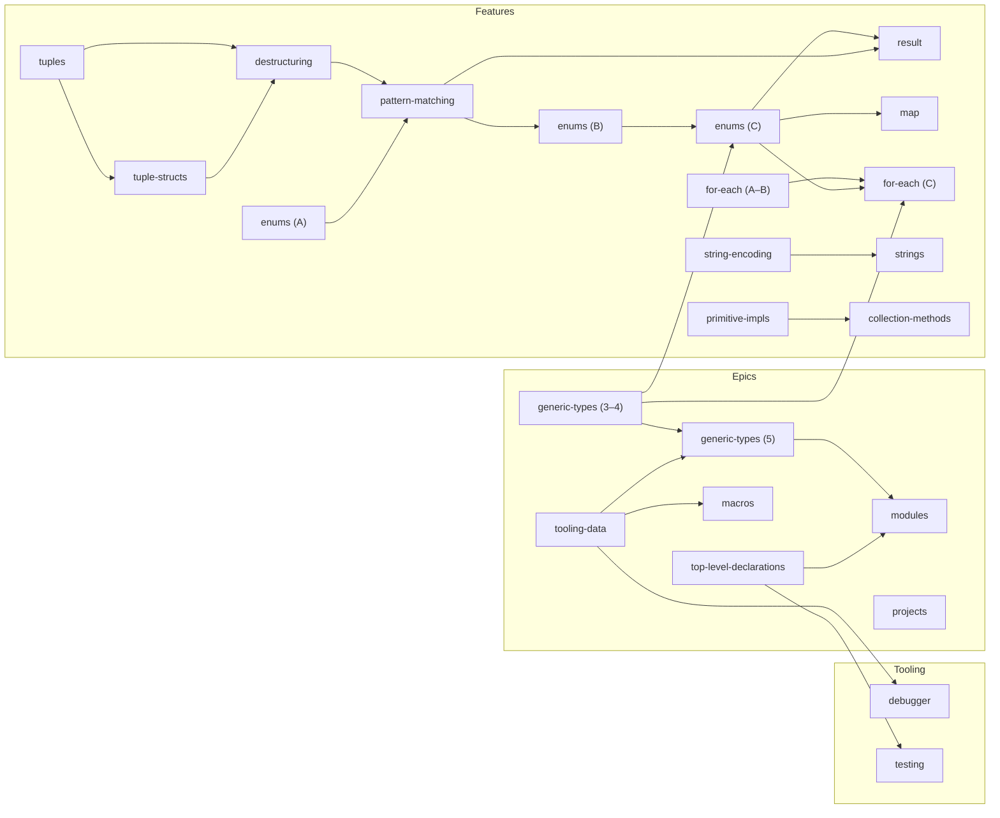

# Roadmap

Proposal categories and the order they have to be built in. A proposal can
start once everything it needs is built. Proposals in the same stage can go in
any order.

Each dependency is explained in the proposal's Related Proposals section.
`enums (C)` means Part C of the [Enums] proposal. Proposals built in parts are
split where the parts need different things.

## Categories

Each proposal has a `category` in its frontmatter.

| Category       | Meaning                                              | May need                  | Needed by                       |
| -------------- | ---------------------------------------------------- | ------------------------- | ------------------------------- |
| `epic`         | Must do. Large changes to the language or toolchain. | epics                     | anything                        |
| `feature`      | Nice to have. Syntax and built-in types.             | epics, features           | features, tooling, experimental |
| `tooling`      | Standalone tools around the language.                | anything but experimental | nothing                         |
| `experimental` | Exploring an idea. Its effects stay inside it.       | anything but experimental | nothing                         |

A proposal that something else needs can't be `experimental`. If one becomes
needed, it moves to another category first.

## Epics

| Stage | Proposal                 | Needs                                     | Notes                                                               |
| ----- | ------------------------ | ----------------------------------------- | ------------------------------------------------------------------- |
| 1     | [Top-Level Declarations] |                                           | Files hold declarations; `main` is called                           |
| 1     | [Tooling Data]           |                                           | Spans on every node; source names; local variable records           |
| 1     | [Generic Types] (3–4)    |                                           | Type parameters and bounds                                          |
| 2     | [Generic Types] (5)      | generic-types (3–4), tooling-data         | Monomorphization. Each copy keeps its source spans                  |
| 2     | [Macros]                 | tooling-data                              | Origins on spans. Design with top-level-declarations ([Q-comptime]) |
| 3     | [Modules]                | generic-types (5), top-level-declarations | Must ship generic bodies ([Q-bodyform])                             |
| 3     | [Projects]               |                                           | Design with modules ([Q-naming]); fills out once modules exist      |

## Features

| Stage | Proposal             | Needs                                              | Notes                                                      |
| ----- | -------------------- | -------------------------------------------------- | ---------------------------------------------------------- |
| 1     | [Tuples]             |                                                    |                                                            |
| 1     | [Enums] (A)          |                                                    | Plain variants                                             |
| 1     | [For-Each] (A–B)     |                                                    | Arrays and ranges                                          |
| 1     | [String Encoding]    |                                                    |                                                            |
| 1     | [Primitive Impls]    |                                                    | [Q-sequencing]                                             |
| 1     | [Trait Types]        |                                                    |                                                            |
| 1     | [Unimplemented]      |                                                    |                                                            |
| 2     | [Tuple Structs]      | tuples                                             |                                                            |
| 2     | [Strings]            | string-encoding                                    |                                                            |
| 2     | [Collection Methods] | primitive-impls                                    | `Map`/`Set` methods wait for generics ([Q-generics-order]) |
| 3     | [Destructuring]      | tuples, tuple-structs                              | Struct and array patterns can start in stage 1             |
| 4     | [Pattern Matching]   | destructuring, enums (A)                           |                                                            |
| 5     | [Enums] (B)          | pattern-matching                                   | Variants with values are unusable without `match`          |
| 6     | [Enums] (C)          | enums (B), **generic-types (3–4)**                 | `Option[T]`, `Result[T, E]`                                |
| 7     | [Result]             | enums (C), pattern-matching                        |                                                            |
| 7     | [Map]                | enums (C)                                          | `@mapGet` returns `Option[V]`                              |
| 7     | [For-Each] (C)       | for-each (A–B), enums (C), **generic-types (3–4)** | `Iterator[T]`                                              |

**Bold** marks an epic.

## Tooling

| Proposal           | Needs                      | Notes                                              |
| ------------------ | -------------------------- | -------------------------------------------------- |
| [Embedded Library] |                            | Part 9 (`krb build`, the `KRBC` format) has landed |
| [Lua Transpiler]   |                            | Easier after top-level-declarations                |
| [Debugger]         | **tooling-data**           | Easier after top-level-declarations                |
| [Testing]          | **top-level-declarations** | Easier after embedded-library                      |

## Experimental

None.

## Graph

Arrow: needed by.

Projects has no arrows: it is designed together with modules. Not shown,
because they need nothing and nothing needs them: trait-types, unimplemented,
embedded-library, lua-transpiler.

## Critical paths

- **Epics:** `generic-types (3–4)` + `tooling-data` → `generic-types (5)` →
  `modules`. Three stages.
- **Features:** `tuples` → `tuple-structs` → `destructuring` →
  `pattern-matching` → `enums (B)` → `enums (C)` → `result`, `map`,
  `for-each (C)`. Seven stages. Joins the epics at `generic-types (3–4)`.
  Everything that uses `Option` or `Result` waits on it.

## Unsettled order

Answering these can move a proposal between stages.

- [Q-generics-order]: collection methods before or after generics.
- [Q-scope-order]: collection methods from lists alone, or after a `Map`/`Set`
  sketch.
- [Q-sequencing]: primitive impls independent of generics (recommended).
- [10.3]: if every operator becomes a trait method, generic-types needs
  primitive-impls first.
- [Q-samples]: when other proposals' samples drop top-level statements.
- Debugger and testing: `krb test` support goes in whichever lands second.

## Closed

[Additional Native Functions], [Prefixed Native Functions],
[String Interpolation], [Sized Number Types], [Lists].

## Link References

[Additional Native Functions]: ./proposals/additional-native-functions/PROPOSAL.md
[Collection Methods]: ./proposals/collection-methods/PROPOSAL.md
[Debugger]: ./proposals/debugger/PROPOSAL.md
[Destructuring]: ./proposals/destructuring/PROPOSAL.md
[Embedded Library]: ./proposals/embedded-library/PROPOSAL.md
[Enums]: ./proposals/enums/PROPOSAL.md
[For-Each]: ./proposals/for-each/PROPOSAL.md
[Generic Types]: ./proposals/generic-types/PROPOSAL.md
[Lists]: ./proposals/lists/PROPOSAL.md
[Lua Transpiler]: ./proposals/lua-transpiler/PROPOSAL.md
[Macros]: ./proposals/macros/PROPOSAL.md
[Map]: ./proposals/map/PROPOSAL.md
[Modules]: ./proposals/modules/PROPOSAL.md
[Pattern Matching]: ./proposals/pattern-matching/PROPOSAL.md
[Prefixed Native Functions]: ./proposals/prefixed-native-functions/PROPOSAL.md
[Primitive Impls]: ./proposals/primitive-impls/PROPOSAL.md
[Projects]: ./proposals/projects/PROPOSAL.md
[Result]: ./proposals/result/PROPOSAL.md
[Sized Number Types]: ./proposals/sized-number-types/PROPOSAL.md
[String Encoding]: ./proposals/string-encoding/PROPOSAL.md
[String Interpolation]: ./proposals/string-interpolation/PROPOSAL.md
[Strings]: ./proposals/strings/PROPOSAL.md
[Testing]: ./proposals/testing/PROPOSAL.md
[Tooling Data]: ./proposals/tooling-support-data/PROPOSAL.md
[Top-Level Declarations]: ./proposals/top-level-declarations/PROPOSAL.md
[Trait Types]: ./proposals/trait-types/PROPOSAL.md
[Tuple Structs]: ./proposals/tuple-structs/PROPOSAL.md
[Tuples]: ./proposals/tuples/PROPOSAL.md
[Unimplemented]: ./proposals/unimplemented/PROPOSAL.md
[Q-generics-order]: ./proposals/collection-methods/PROPOSAL.md#q-does-this-wait-on-generics-or-ship-an-untyped-version-first
[Q-scope-order]: ./proposals/collection-methods/PROPOSAL.md#q-should-this-start-from-arrays-alone-or-wait-until-tuplessetmap-are-at-least-sketched
[Q-sequencing]: ./proposals/primitive-impls/PROPOSAL.md#q-should-this-land-before-after-or-independent-of-the-generic-types-proposals-operator-dispatch-decision
[Q-bodyform]: ./proposals/modules/PROPOSAL.md#q-in-what-form-does-a-module-ship-its-generic-bodies
[Q-naming]: ./proposals/modules/PROPOSAL.md#q-is-a-module-named-by-its-file-path-or-by-a-namespace
[Q-samples]: ./proposals/top-level-declarations/PROPOSAL.md#q-when-do-code-samples-in-other-proposals-change
[Q-comptime]: ./proposals/top-level-declarations/PROPOSAL.md#q-how-much-is-a-comptime-value
[10.3]: ./proposals/generic-types/PROPOSAL.md#103-operators-for-primitives-built-in-fast-path-or-uniform-trait-dispatch
